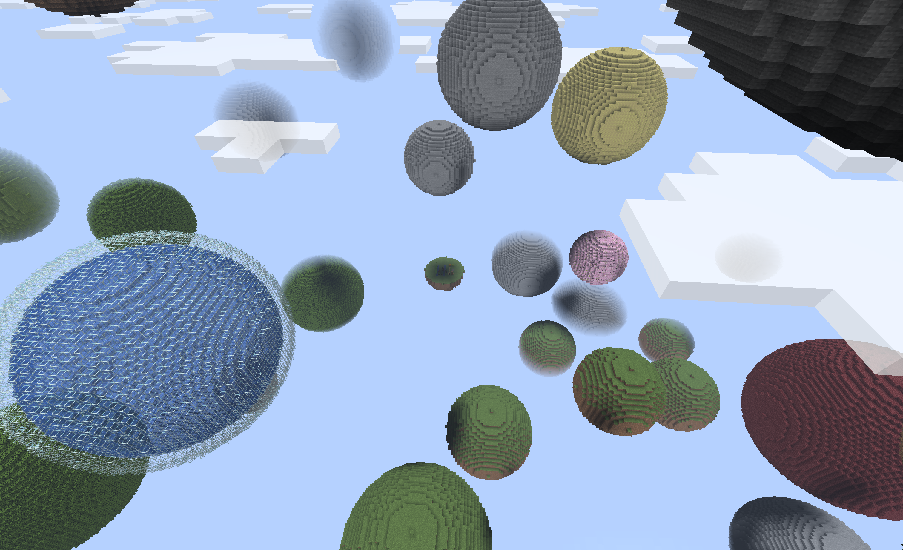

# Planetoids

A remake of the classic floating-planet world generator for Minecraft Java Edition, inspired by [Seibai's original Planetoids generator](https://www.minecraftforum.net/forums/mapping-and-modding-java-edition/minecraft-tools/1260575-new-map-generator-planetoids-v1-75-now-up).

Requires **Paper 26.3** and **JDK 25**. The build targets Paper build 243.



## Build and test

Set `JAVA_HOME` to JDK 25, then run:

```sh
./gradlew build
```

The plugin JAR is in `paper/build/libs/`. It includes the standalone `core` library. Run `./gradlew test` to run tests separately. Gradle and dependencies are downloaded automatically on the first build.

GitHub Actions builds and tests pushes and pull requests. Version tags (for example, `1.0` or `v1.1`) publish the tested plugin JAR to [GitHub Releases](https://github.com/oscarcs/planetoids/releases) and [Hangar](https://hangar.papermc.io/oscarcs/planetoids); the tag must match `version` in `gradle.properties` (with an optional `v` prefix).

Hangar publishing uses the `HANGAR_API_TOKEN` repository secret, with `create_version` permission for this project. To publish an existing GitHub release, run the **Publish to Hangar** action with its tag.

## Run locally

1. Download [Paper 26.3](https://papermc.io/downloads/paper) into a fresh `run/` directory as `paper.jar`.
2. Copy the plugin JAR into `run/plugins/`.
3. Create these settings **before generating the world**:

   `run/server.properties`:
   ```properties
   server-ip=127.0.0.1
   level-name=planetoids
   level-seed=123456789
   gamemode=survival
   spawn-protection=0
   generate-structures=false
   ```

   `run/bukkit.yml`:
   ```yaml
   worlds:
     planetoids:
       generator: Planetoids
   ```

4. Start the server from `run/`:
   ```sh
   java -Xms1G -Xmx2G -jar paper.jar --nogui
   ```
   On first launch, read the Minecraft EULA linked in `eula.txt`. If you agree, set `eula=true` and start again.
5. Connect with a Minecraft Java 26.3 client to `localhost:25565`. Enter `stop` in the server console to save and shut down.

Unlike the original, the game can be beaten in survival: type `/planetoids guide` in game for hints.

## Configuration

Paper creates `plugins/Planetoids/config.yml` on first load. It controls planet geometry, weighted materials, progression, and the world base (`nothing`, `water`, or `lava`). For liquid bases, `height` is the top liquid block's Y coordinate and `depth` excludes the bedrock layer underneath.

Stop the server before editing settings. **Use a fresh world after changing generation settings** to avoid seams or overlapping terrain. Existing configs are not overwritten when the plugin is updated; see the [bundled config](paper/src/main/resources/config.yml) for available options.
